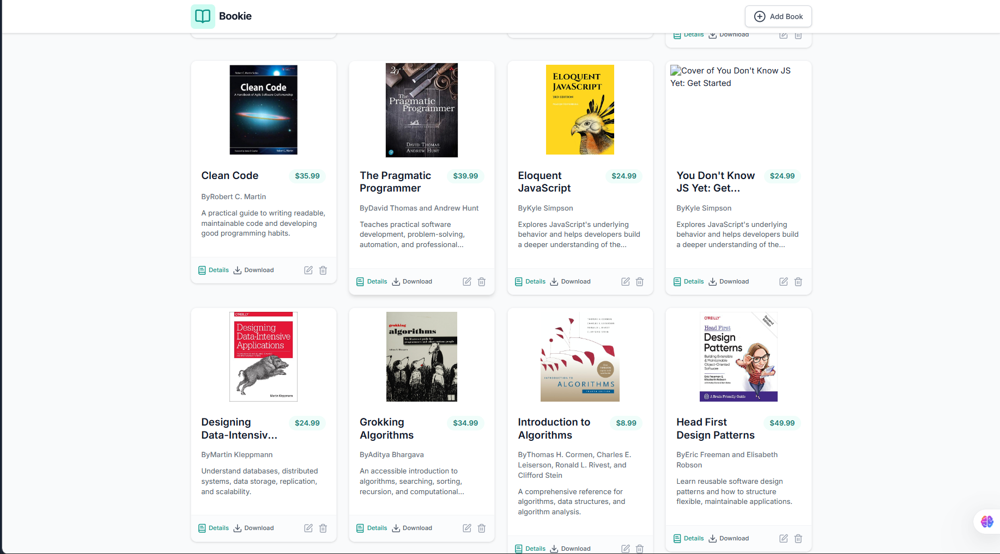

# Bookie
## Looke here: https://bookie-4m7s.onrender.com/
A full-stack personal library manager for organizing books, tracking prices, and opening optional book download links. Bookie includes a responsive React interface and a REST API backed by MongoDB.



## Features

- Browse books in a responsive card layout.
- View book details, including the title, author, price, cover, description, and date added.
- Add books with required details and optional cover-image and download URLs.
- Edit existing book records.
- Delete books with a confirmation dialog.
- Open optional download links hosted by external providers.
- See loading, empty-library, and API-error states with a retry action.
- Persist book records in MongoDB through the Express API.

## Built with

| Part | Technologies |
| --- | --- |
| Frontend | React 19, Vite 8, React Router 7, Redux Toolkit, Tailwind CSS 4, Lucide, React Hot Toast |
| Backend | Node.js, Express 5, Mongoose 9 |
| Database | MongoDB |

## Requirements

- Node.js compatible with Vite 8 and npm.
- MongoDB, running locally or available through MongoDB Atlas.

## Run locally

### 1. Configure the backend

Create a `.env` file in the repository root:

```env
MONGO_URI=mongodb://127.0.0.1:27017/bookie
PORT=5000
```

Use your MongoDB Atlas connection string for `MONGO_URI` if you are using a hosted database. Keep `.env` private; do not commit database credentials.

### 2. Install dependencies

From the repository root:

```sh
npm install
npm --prefix frontend install
```

### 3. Start the backend

In one terminal at the repository root:

```sh
npm run dev
```

The API starts at `http://localhost:5000` by default. Set `PORT` in the root `.env` file to use a different port.

### 4. Start the frontend

In a second terminal at the repository root:

```sh
npm --prefix frontend run dev
```

Open the local URL printed by Vite (usually `http://localhost:5173`).

## Deploy online

Bookie can run as a **single Node.js web service**: in production, Express serves both the API and the built React app. The steps below use Render for the web service and MongoDB Atlas for the database; the same build and start commands can be used with another Node.js host.

### 1. Create a MongoDB Atlas database

1. Create an Atlas cluster and a database user with a strong password.
2. Configure Atlas Network Access to allow connections from your hosting provider. If the provider does not offer stable outbound IP addresses, you may need to allow `0.0.0.0/0`; use a strong database password and restrict access where possible.
3. Copy the Atlas connection string. Replace its password placeholder and include the database name `bookie`, for example:

   ```text
   mongodb+srv://<username>:<password>@<cluster-host>/bookie?retryWrites=true&w=majority
   ```

### 2. Create the web service

1. Push the project to GitHub and create a new **Web Service** from the `brahim1-dev/Bookie` repository in Render.
2. Leave the Root Directory blank so Render uses the repository root.
3. Configure the service:

   | Setting | Value |
   | --- | --- |
   | Runtime | Node |
   | Build Command | `npm run build` |
   | Start Command | `npm start` |

4. Add these environment variables in the hosting dashboard:

   | Variable | Value |
   | --- | --- |
   | `MONGO_URI` | Your complete MongoDB Atlas connection string. |
   | `NODE_ENV` | `production` |
   | `VITE_API_URL` | `/api/books` |

   Do not set `PORT` manually on Render; the service provides it. `VITE_API_URL` is used during the frontend build, and `/api/books` makes the deployed app send API requests to the same origin.

5. Deploy the service. The build installs the frontend dependencies and creates `frontend/dist`; the start command connects to MongoDB and starts Express, which serves the API and frontend from the same service.

### 3. Verify the deployment

- Open the service URL to check that the Bookie interface loads.
- Open `<your-service-url>/api/books` to check that the API responds with the book list (an empty JSON array is expected before books are added).
- Add a book, refresh the page, and verify that it remains in the library.
- Open a book details or edit URL directly, then refresh, to verify that frontend routes are served correctly.

If deployment fails, check the service build/runtime logs, confirm the Atlas connection string and Network Access settings, and verify that `NODE_ENV` and `VITE_API_URL` were set before the most recent build.

## Configuration

### Backend environment

| Variable | Required | Default | Description |
| --- | --- | --- | --- |
| `MONGO_URI` | Yes | — | MongoDB connection string. The backend exits with an error if it cannot connect. |
| `PORT` | No | `5000` | Port used by the Express server. |

### Frontend environment

The frontend defaults to `http://localhost:5000/api/books`. To use a different API base URL, create `frontend/.env`:

```env
VITE_API_URL=https://your-api-host.example/api/books
```

Restart Vite after changing environment variables. The URL should point to the books resource, not just the server root.

## API

Base URL: `http://localhost:5000/api/books`

| Method | Endpoint | Description |
| --- | --- | --- |
| `GET` | `/` | List all books. |
| `GET` | `/:id` | Get one book by MongoDB ID. |
| `POST` | `/` | Create a book. |
| `PUT` | `/:id` | Update a book. |
| `DELETE` | `/:id` | Delete a book. |

### Book fields

| Field | Type | Required | Description |
| --- | --- | --- | --- |
| `title` | String | Yes | Book title. |
| `author` | String | Yes | Author name. |
| `price` | String | Yes | Price shown in the interface. |
| `description` | String | Yes | Book description. |
| `coverImage` | String | No | URL of the book cover image. |
| `downloadLink` | String | No | External URL for a download. |
| `createdAt`, `updatedAt` | Date | Automatic | Mongoose timestamps. |

Example `POST /api/books` request:

```json
{
  "title": "The Pragmatic Programmer",
  "author": "Andrew Hunt and David Thomas",
  "price": 39.99,
  "description": "A practical guide to software craftsmanship.",
  "coverImage": "https://example.com/cover.jpg",
  "downloadLink": "https://example.com/book"
}
```

The backend requires a non-empty title, author, and description, plus a price. Cover and download URLs are optional. Bookie stores the download URL; it does not host or serve book files.

## Project structure

```text
Bookie/
├── backend/
│   ├── config/             # MongoDB connection
│   ├── controllers/        # Book CRUD handlers
│   ├── models/             # Mongoose book schema
│   ├── routes/             # REST API routes
│   └── server.js           # Express startup
├── frontend/
│   ├── src/
│   │   ├── components/     # Shared UI, book form, cards, and dialog
│   │   ├── pages/          # Library, details, add, and edit screens
│   │   └── redux/          # Store and book API state
│   └── package.json
├── .env                    # Local backend configuration (not committed)
└── package.json            # Backend scripts and dependencies
```

## Useful commands

Run backend commands from the repository root and frontend commands using `npm --prefix frontend`.

| Command | Description |
| --- | --- |
| `npm run dev` | Start the backend with Node watch mode. |
| `npm start` | Start the backend normally. |
| `npm --prefix frontend run dev` | Start the Vite development server. |
| `npm --prefix frontend run build` | Build the frontend for production. |
| `npm --prefix frontend run preview` | Preview the production build locally. |
| `npm --prefix frontend run lint` | Run ESLint across the frontend. |

## Troubleshooting

- **The API cannot connect to MongoDB:** Confirm MongoDB is running and `MONGO_URI` is correct in the repository-root `.env` file.
- **The frontend cannot reach the API:** Start the backend and confirm `VITE_API_URL` (if configured) points to the correct `/api/books` URL.
- **A book cannot be saved:** Check that title, author, price, and description are provided. The cover and download URLs can be left blank.
- **A download link does not open or download:** The link is served by an external host, so its availability and download behavior depend on that provider.

## Repository

[brahim1-dev/Bookie on GitHub](https://github.com/brahim1-dev/Bookie)
